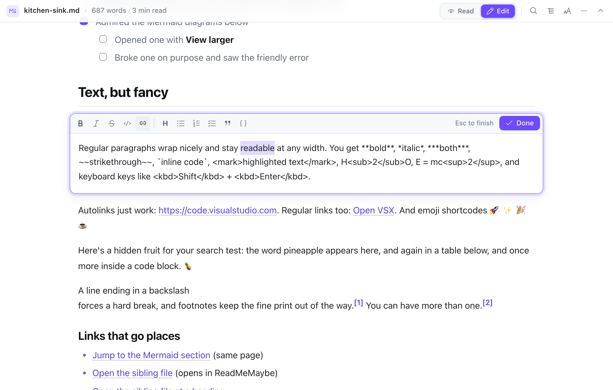
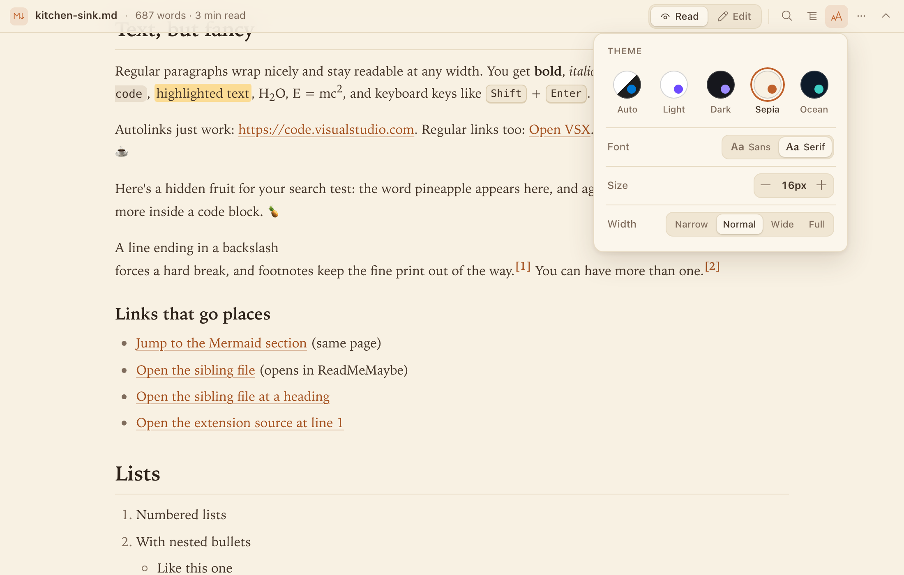
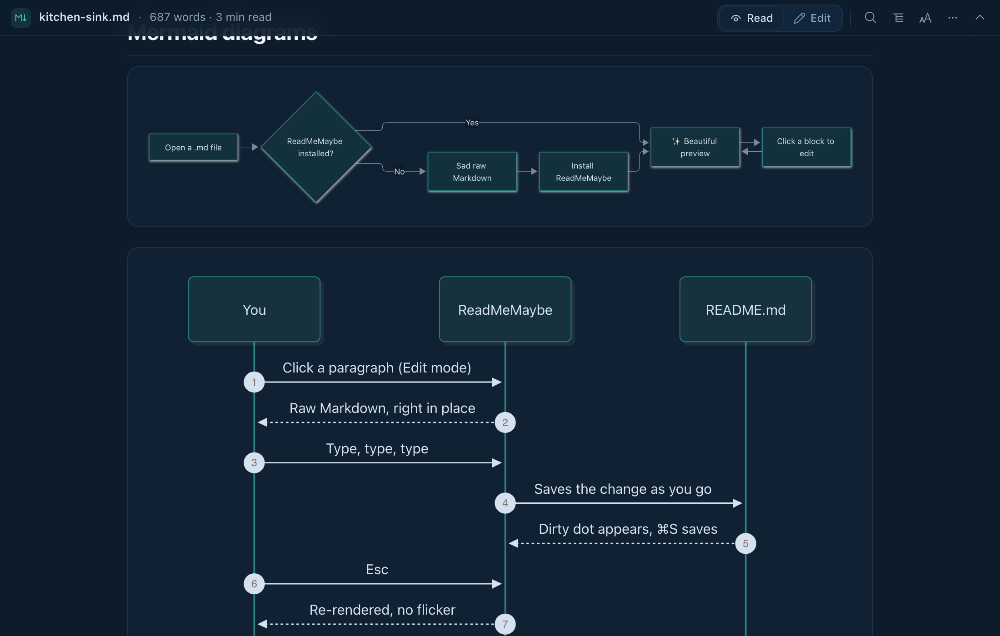

<p align="center">
  
</p>

<h1 align="center">ReadMeMaybe</h1>

<p align="center">
  <b>Hey, I just met you, and this is crazy…<br>but here's your Markdown, so read it, maybe? 📞</b>
</p>

<p align="center">
  A beautiful Markdown preview <i>and</i> in-place editor for <b>VS Code</b> and <b>Antigravity</b>.<br>
  Install it. That's the setup. There is no step two.
</p>



## The problem (a tragedy in six acts)

You open a `README.md` and…

1. 😐 **It's raw.** A wall of `#`, `**` and `|---|---|`. You wanted a document, not a ransom note.
2. 🪟 **"Open Preview to the Side."** Congratulations, you now have two of everything and half a screen for each.
3. ✏️ **You want to fix one typo.** The "editor" opens a split view of the raw file and wishes you luck finding the line.
4. 🖱️ **You select some text to copy it.** *Surprise!* Another split view. Nobody asked for that.
5. 🔍 **You press <kbd>⌘F</kbd>.** Nothing happens. Rendered text is apparently classified.
6. 🎨 **You'd like a different theme.** You get the one you get. Mermaid diagrams? That's another extension. Have fun.

## The fix

ReadMeMaybe opens **every** `.md` file as a clean, readable page, automatically. No commands, no settings, no "Open Preview" dance.

| You want to… | You do… |
| --- | --- |
| **Read** | Nothing. It's already rendered. |
| **Edit** | Press <kbd>⌘E</kbd> / <kbd>Ctrl+E</kbd>, click any block, type. <kbd>Esc</kbd> when done. It edits *right where it sits*. |
| **Find** | <kbd>⌘F</kbd> / <kbd>Ctrl+F</kbd>. Matches light up, even inside collapsed `<details>`. |
| **Copy** | Select and copy. Nothing pops open. Code blocks have a copy button too. |
| **Change the vibe** | Click **Aa**: Auto, Light, Dark, Sepia, Ocean · Sans or Serif · text size · width. |
| **Get around** | Outline drawer, heading anchors, and links that open other docs (even `other.md#some-heading`). |
| **Focus** | Collapse the toolbar with **⌃**. It stays out of your way until you want it. |
| **See the raw text** | **⋯ → Open as plain text**. Same tab, no split. **Open in ReadMeMaybe** brings you back. |

## What's in the box

- **Rendering that doesn't look like 2009.** GitHub-flavored tables, clickable task lists (they save to the file!), GitHub alerts (`> [!TIP]`), footnotes, emoji `:tada:`, front matter, syntax highlighting, raw HTML, and images relative to your file.
- **Mermaid, built in.** Flowcharts, sequence diagrams, pie charts, state machines, and friends, themed to match your reading theme and loaded only when a doc actually has one. Broken diagram? You get a friendly error card, not a mysterious blank box.
- **Editing without the ceremony.** A tiny format bar, <kbd>⌘B</kbd> / <kbd>⌘I</kbd> / <kbd>⌘K</kbd>, <kbd>Tab</kbd> to indent, and <kbd>Enter</kbd> continues your lists. Changes go straight into the real document, so the dirty dot, undo, <kbd>⌘S</kbd> and git all behave exactly like you'd expect.
- **Live updates.** When something else changes the file (a `git pull`, another editor, your AI agent scribbling an implementation plan), the page updates in place. Unchanged parts don't even flicker.

<table>
  <tr>
    <td></td>
    <td></td>
  </tr>
</table>

## Settings

Everything is also one click away in the **Aa** menu.

| Setting | Default | What it does |
| --- | --- | --- |
| `readMeMaybe.theme` | `auto` | `auto` follows your editor theme, or pick `light`, `dark`, `sepia`, `ocean` |
| `readMeMaybe.fontFamily` | `sans` | `sans` or `serif` for reading |
| `readMeMaybe.fontSize` | `16` | Base text size in px (12–26) |
| `readMeMaybe.contentWidth` | `normal` | `narrow`, `normal`, `wide` or `full` |
| `readMeMaybe.startInEditMode` | `false` | Open files ready to edit |

## FAQ (Frequently Anticipated Quibbles)

**I need the plain text editor for one file.**
**⋯ → Open as plain text**, or right-click the tab → *Reopen Editor With…* → *Text Editor*.

**I want plain text for *all* Markdown files.**
Run **ReadMeMaybe: Toggle Auto-Open for Markdown Files**. Run it again when you miss me. I'll be by the phone. 📞

**What about git diffs?**
Diffs stay regular side-by-side text diffs. ReadMeMaybe only takes over when you open a file.

**Does it work in Antigravity?**
Yes. It's tested in VS Code 1.146 and Antigravity IDE 1.107. Install it from Open VSX or from the `.vsix`.

**Can a sketchy Markdown file run scripts?**
No. The preview runs under a strict Content Security Policy and all HTML is sanitized. Links only open when you click them.

## Try it

Open [`examples/kitchen-sink.md`](examples/kitchen-sink.md). It throws everything at the renderer and comes with a checklist to tick off as you go.

## Development

```bash
npm install
npm run dev               # browser harness at http://localhost:5179 (fake VS Code host)
npm test                  # unit tests
npm run test:integration  # runs the extension inside a real VS Code instance
npm run package           # builds read-me-maybe-<version>.vsix
```

Press <kbd>F5</kbd> in VS Code to launch an Extension Development Host with the examples folder open.

Before publishing, set your own `publisher` (and ideally `repository`) in `package.json`. With a repository set, you can drop `--no-rewrite-relative-links` from the `package` script so the screenshots resolve on the Marketplace.

## License

[MIT](LICENSE). Call me, maybe. ✨
