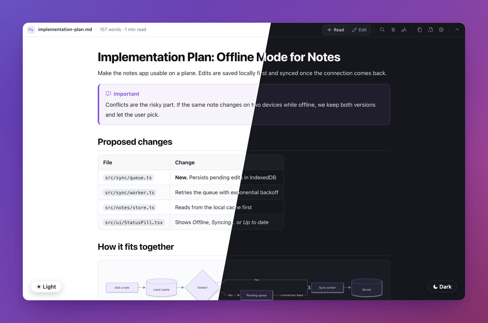
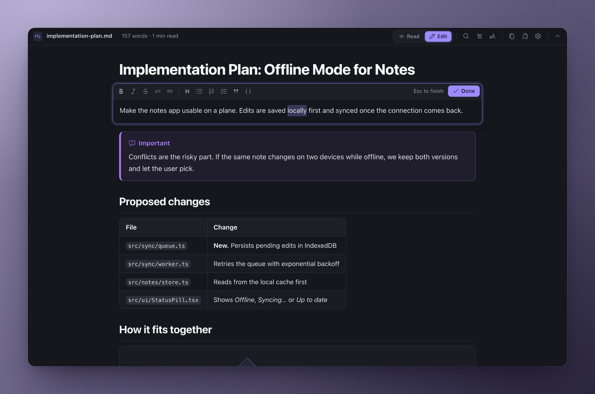
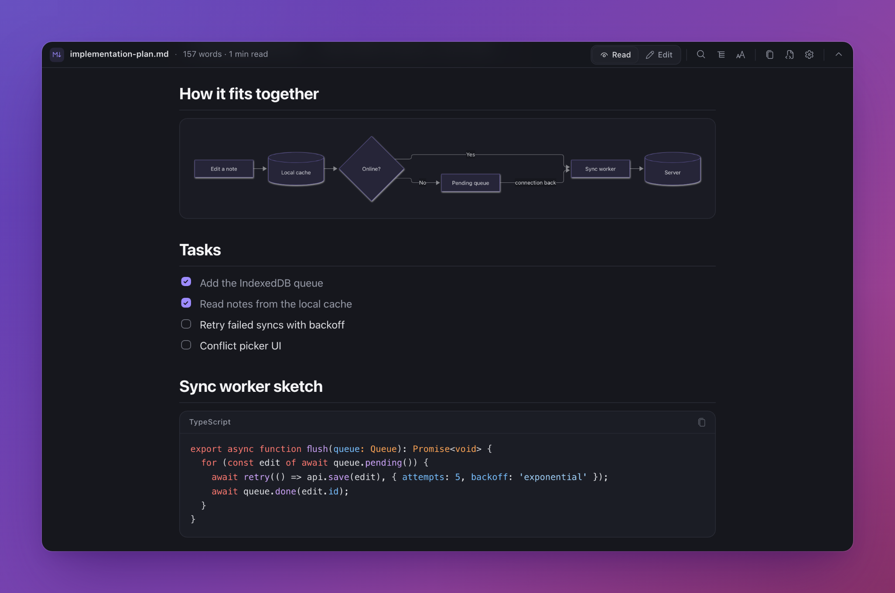
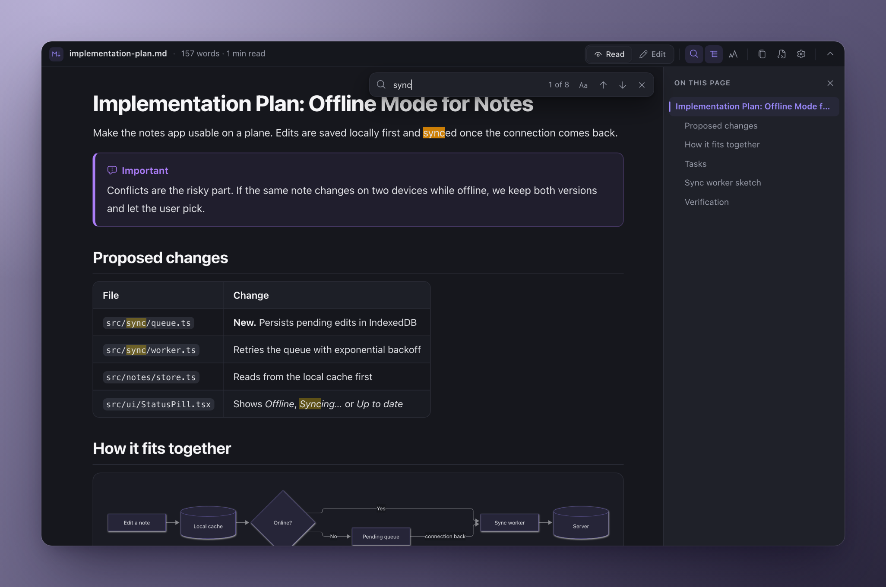
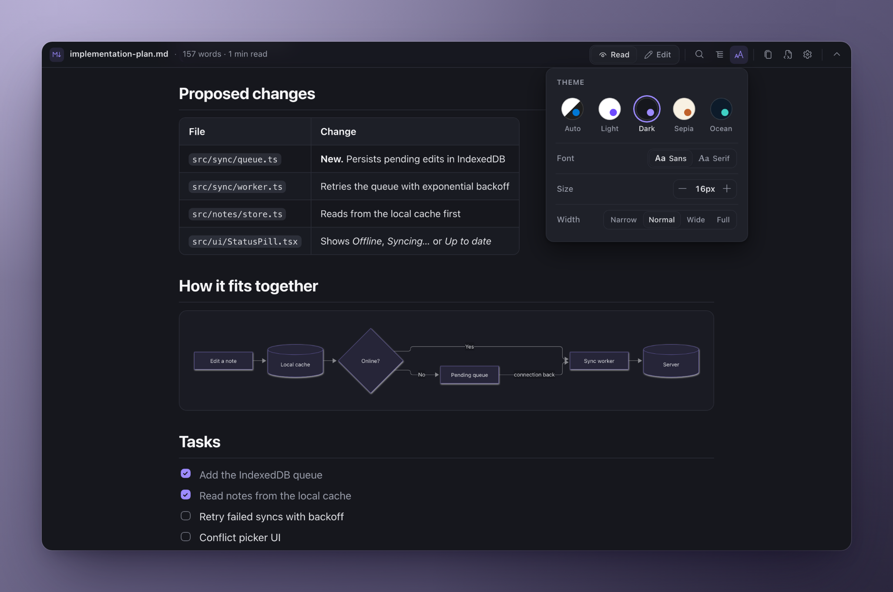

<p align="center">
  
</p>

<h1 align="center">ReadMeMaybe</h1>

<p align="center">
  <b>Hey, I just met you, and this is crazy…<br>but here's your Markdown, so read it, maybe? 📞</b>
</p>

<p align="center">
  A beautiful Markdown preview <i>and</i> in-place editor for <b>VS Code</b> and <b>Antigravity</b>.<br>
  Install it. That's the setup. There is no step two.
</p>



## The problem (a tragedy in six acts)

You open a `README.md` and…

1. 😐 **It's raw.** A wall of `#`, `**` and `|---|---|`. You wanted a document, not a ransom note.
2. 🪟 **"Open Preview to the Side."** Congratulations, you now have two of everything and half a screen for each.
3. ✏️ **You want to fix one typo.** The "editor" opens a split view of the raw file and wishes you luck finding the line.
4. 🖱️ **You select some text to copy it.** *Surprise!* Another split view. Nobody asked for that.
5. 🔍 **You press <kbd>⌘F</kbd>.** Nothing happens. Rendered text is apparently classified.
6. 🎨 **You'd like a different theme.** You get the one you get. Mermaid diagrams? That's another extension. Have fun.

## The fix

ReadMeMaybe opens **every** `.md` file as a clean, readable page, automatically. No commands, no settings, no "Open Preview" dance.

| You want to… | You do… |
| --- | --- |
| **Read** | Nothing. It's already rendered. |
| **Edit** | Press <kbd>⌘E</kbd> / <kbd>Ctrl+E</kbd>, click any block, type. <kbd>Esc</kbd> when done. It edits *right where it sits*. |
| **Find** | <kbd>⌘F</kbd> / <kbd>Ctrl+F</kbd>. Matches light up, even inside collapsed `<details>`. |
| **Copy** | Select and copy. Nothing pops open. Code blocks have their own copy button. |
| **Change the look** | Click **Aa**: Auto, Light, Dark, Sepia or Ocean, sans or serif, text size and width. |
| **Get around** | Outline panel, heading anchors, and links that open other docs (even `other.md#some-heading`). |
| **Focus** | Hide the toolbar with **⌃**. It comes back when you want it. |
| **See the raw text** | Click **Open as plain text** in the toolbar. Same tab, no split. **Open in ReadMeMaybe** brings you back. |

## A closer look

<table>
  <tr>
    <td width="50%" valign="top">
      
      <p><b>Edit in place.</b> Click a block and it turns into Markdown right where it is, with a small format bar.</p>
    </td>
    <td width="50%" valign="top">
      
      <p><b>Diagrams, tasks and code.</b> Mermaid is built in, checkboxes save to the file, and code is highlighted.</p>
    </td>
  </tr>
  <tr>
    <td width="50%" valign="top">
      
      <p><b>Find and outline.</b> Search the rendered page and jump between sections.</p>
    </td>
    <td width="50%" valign="top">
      
      <p><b>Make it yours.</b> Five themes, two fonts, and adjustable size and width.</p>
    </td>
  </tr>
</table>

## What's in the box

- **The Markdown you actually use.** GitHub tables, task lists, alerts like `> [!TIP]`, footnotes, emoji, front matter, syntax highlighting, HTML, and images relative to your file.
- **Mermaid diagrams.** Flowcharts, sequence diagrams, pie charts and more, matched to your theme. A broken diagram shows Mermaid's error message instead of an empty box.
- **Edits that are real edits.** Changes go straight into the file, so the unsaved dot, undo, <kbd>⌘S</kbd> and git work as usual. There's <kbd>⌘B</kbd> / <kbd>⌘I</kbd> / <kbd>⌘K</kbd>, <kbd>Tab</kbd> to indent, and <kbd>Enter</kbd> continues a list.
- **Live updates.** If the file changes elsewhere (git, another editor, an AI agent writing a plan), the page refreshes in place.

## Settings

All of these are also in the **Aa** panel.

| Setting | Default | What it does |
| --- | --- | --- |
| `readMeMaybe.theme` | `auto` | `auto` follows your editor theme, or pick `light`, `dark`, `sepia`, `ocean` |
| `readMeMaybe.fontFamily` | `sans` | `sans` or `serif` |
| `readMeMaybe.fontSize` | `16` | Base text size in px (12–26) |
| `readMeMaybe.contentWidth` | `normal` | `narrow`, `normal`, `wide` or `full` |
| `readMeMaybe.startInEditMode` | `false` | Open files ready to edit |

## FAQ

**Can I get the plain text editor back?**
For one file, click **Open as plain text** in the toolbar. For all Markdown files, run **ReadMeMaybe: Toggle Auto-Open for Markdown Files**, and run it again whenever you want ReadMeMaybe back.

**What about git diffs?**
They stay normal side-by-side text diffs.

**Does it work in Antigravity?**
Yes. It's tested in VS Code 1.146 and Antigravity IDE 1.107, and installs from Open VSX.

**Is it safe to open files I didn't write?**
Yes. Scripts in Markdown never run, HTML is sanitized, and links only open when you click them.

## How to contribute

Bug reports, ideas and pull requests are all welcome.

- **Found a bug or have an idea?** [Open an issue](https://github.com/sachin-dahal/read-me-maybe/issues). A small Markdown snippet that shows the problem helps a lot.
- **Want to send a fix?** Clone the repo and start the dev preview:

  ```bash
  git clone https://github.com/sachin-dahal/read-me-maybe.git
  cd read-me-maybe
  npm install
  npm run dev   # live preview in your browser at http://localhost:5179
  ```

  Press <kbd>F5</kbd> in VS Code to try your changes in a new window with the example files open. Run `npm test` before opening a pull request, and keep the promise in mind: users install it and it just works, with no extra setup.

## License

[MIT](LICENSE)
