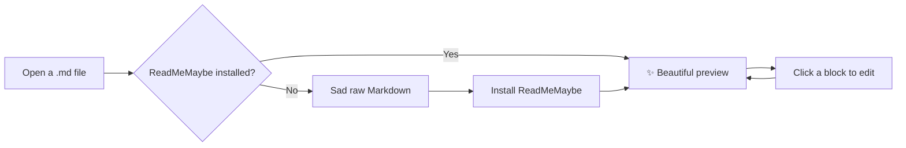
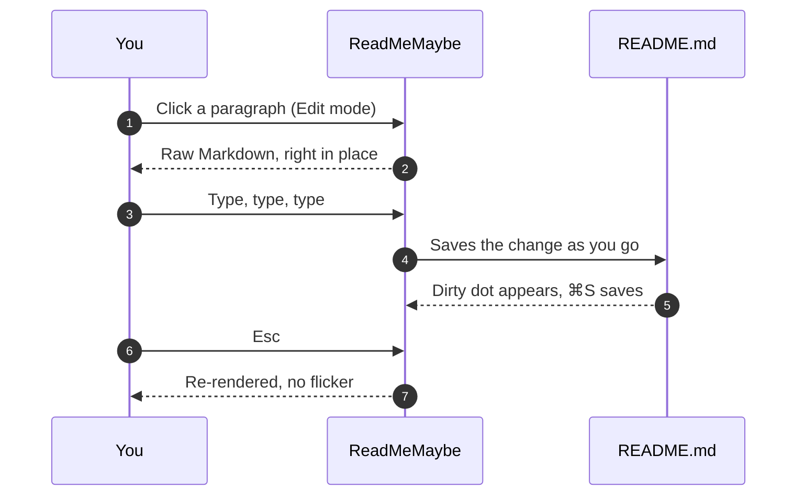
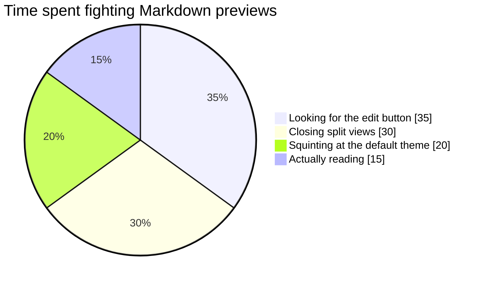
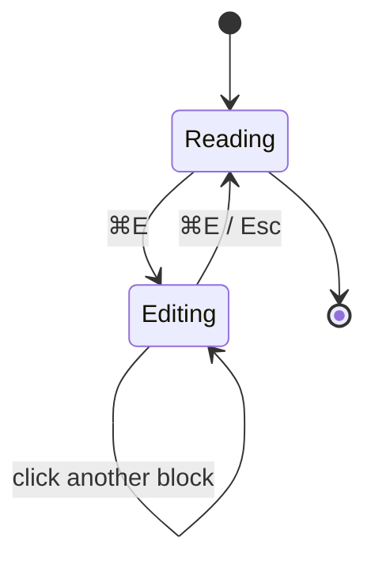

# The ReadMeMaybe Kitchen Sink 🧽

Welcome to the test drive. This file throws **everything** at the renderer so you can see what breaks (spoiler: hopefully nothing). Open it, poke it, edit it, theme it.

> [!TIP]
> Press <kbd>⌘</kbd> <kbd>E</kbd> (or <kbd>Ctrl</kbd> <kbd>E</kbd>) to flip into **Edit mode**, then click any block on this page. It turns into Markdown right where it sits. No split view, no second tab.

## Your test checklist

Tick these off as you go. Yes, the checkboxes are real and they save to the file.

- [ ] The file opened in ReadMeMaybe on its own, without any clicking around
- [ ] Switched themes from the **Aa** menu (try *Sepia* with a coffee ☕)
- [ ] Found the word `pineapple` with <kbd>⌘</kbd> <kbd>F</kbd>
- [ ] Selected and copied text without anything weird popping open
- [ ] Edited a paragraph in place, pressed <kbd>Esc</kbd>, and saw it re-render
- [ ] Collapsed the toolbar with the **⌃** button, then brought it back
- [x] Admired the Mermaid diagrams below
  - [ ] Opened one with **View larger**
  - [ ] Broke one on purpose and saw the friendly error

## Text, but fancy

Regular paragraphs wrap nicely and stay readable at any width. You get **bold**, *italic*, ***both***, ~~strikethrough~~, `inline code`, <mark>highlighted text</mark>, H<sub>2</sub>O, E = mc<sup>2</sup>, and keyboard keys like <kbd>Shift</kbd> + <kbd>Enter</kbd>.

Autolinks just work: https://code.visualstudio.com. Regular links too: [Open VSX](https://open-vsx.org). And emoji shortcodes :rocket: :sparkles: :tada: :coffee:

Here's a hidden fruit for your search test: the word pineapple appears here, and again in a table below, and once more inside a code block. 🍍

A line ending in a backslash\
forces a hard break, and footnotes keep the fine print out of the way.[^fine-print] You can have more than one.[^two]

### Links that go places

- [Jump to the Mermaid section](#mermaid-diagrams) (same page)
- [Open the sibling file](./another-file.md) (opens in ReadMeMaybe)
- [Open the sibling file at a heading](./another-file.md#a-heading-worth-linking)
- [Open the extension source at line 1](../src/extension.ts#L1)

## Lists

1. Numbered lists
2. With nested bullets
   - Like this one
   - And this one
     1. Even deeper
     2. Still going
3. And back out again

- Bullets can hold paragraphs too.

  Like this second paragraph inside the same item.

- And code:

  ```bash
  npm install --save-dev vibes
  ```

## Alerts (GitHub style)

> [!NOTE]
> Useful information that users should know, even when skimming.

> [!TIP]
> Helpful advice for doing things better or more easily.

> [!IMPORTANT]
> Key information users need to know to achieve their goal.

> [!WARNING]
> Urgent info that needs immediate user attention to avoid problems.

> [!CAUTION]
> Advises about risks or negative outcomes of certain actions.

> And a plain old blockquote, for when you just want to quote someone.
> "Hey, I just met you, and this is crazy, but here's my Markdown, so render it, maybe?"

## Tables

| Feature            | Other extensions        | ReadMeMaybe         |
| :----------------- | :---------------------: | ------------------: |
| Opens by itself    | 🤷 Sometimes            | ✅ Always           |
| Edit in place      | ❌ Split view of doom   | ✅ Click a block    |
| Search             | ❌ Nope                 | ✅ <kbd>⌘F</kbd>    |
| Themes             | 😐 The one you get      | ✅ Five, plus Auto  |
| Mermaid            | 🧩 Extra extension      | ✅ Built in         |
| Favorite fruit     | n/a                     | 🍍 pineapple        |

A wide table, to test horizontal scrolling:

| Step | Owner | Status | Started | Finished | Duration | Notes | More notes | Even more notes |
| ---- | ----- | ------ | ------- | -------- | -------- | ----- | ---------- | --------------- |
| Plan | Agent | Done | 09:00 | 09:12 | 12m | Wrote an implementation plan | Rendered beautifully | Obviously |
| Build | Agent | Done | 09:12 | 10:40 | 88m | Many files | Some coffee | No regrets |

## Code

```typescript
// Syntax highlighting adapts to every theme.
interface Song {
  title: string;
  catchy: boolean;
}

export function callMeMaybe(song: Song): string {
  const pineapple = '🍍';
  return song.catchy ? `${song.title} is stuck in my head ${pineapple}` : 'meh';
}
```

```python
from dataclasses import dataclass

@dataclass
class Preview:
    theme: str = "sepia"

    def render(self, markdown: str) -> str:
        return f"<article class='{self.theme}'>{markdown}</article>"
```

```json
{
  "readMeMaybe.theme": "auto",
  "readMeMaybe.fontSize": 16,
  "readMeMaybe.contentWidth": "normal"
}
```

```diff
- Install three extensions, configure two, still no search
+ Install ReadMeMaybe. That's it. That's the setup.
```

```
A plain block with no language. Still gets a copy button.
```

## Mermaid diagrams









And one that's broken on purpose, so you can see the error card:

```mermaid
flowchart TD
    A[This arrow goes nowhere] -->
```

## Images

Local images resolve relative to this file:


## Raw HTML

<details>
<summary>Click to reveal a secret</summary>

The secret is that `<details>` blocks work, and search opens them when a match is hiding inside. Try searching for **flamingo**. 🦩

</details>

<p align="center">Centered with plain HTML, because sometimes you just need to.</p>

---

## Edit playground

Switch to Edit mode and mess with this section. Some ideas:

- Click this list and press <kbd>Enter</kbd> at the end of an item. The bullet continues.
- Select a word and hit <kbd>⌘</kbd> <kbd>B</kbd> to make it bold.
- Press <kbd>Tab</kbd> to indent a list item and <kbd>Shift</kbd> <kbd>Tab</kbd> to outdent it.
- Use the **H** button to cycle a line through heading levels.

This paragraph is a great one to edit. Change a word, press <kbd>Esc</kbd>, and watch it re-render.

[^fine-print]: Footnotes render at the bottom with a link back up. Fancy.
[^two]: Told you there could be more than one.
